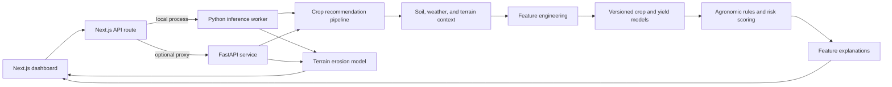

# GeoAgri-AI

**An explainable, geospatial agricultural decision-support system for crop suitability and terrain risk.**

[](https://www.python.org/)
[](https://nextjs.org/)
[](LICENSE)

GeoAgri-AI brings location-based soil, weather, and terrain context together with machine-learning models and agronomic rules. It provides ranked crop recommendations, yield and risk context, explanations, and an interactive dashboard for exploring locations in India.

> **Scope note:** This is a research and decision-support project, not a substitute for local agronomists, field measurements, or official agricultural guidance. Recommendations depend on the quality and coverage of the available data.

## Contents

- [What it does](#what-it-does)
- [How it works](#how-it-works)
- [Technology](#technology)
- [Get started](#get-started)
- [Configuration](#configuration)
- [Use the API](#use-the-api)
- [Tests and development](#tests-and-development)
- [Data, models, and limitations](#data-models-and-limitations)
- [Repository layout](#repository-layout)
- [Documentation](#documentation)
- [License](#license)

## What it does

- **Crop intelligence:** ranks candidate crops for a location and season using a versioned crop model, engineered agronomic features, and physiological compatibility rules.
- **Yield and risk context:** includes yield estimates and environmental risk indicators in crop recommendations.
- **Terrain analysis:** provides point-based erosion-risk estimates and map-based exploration.
- **Explainability:** returns feature attributions and supporting agronomic factors; optional Groq-powered text explanations can be enabled with an API key.
- **Interactive dashboard:** a Next.js application with map-based location selection, crop intelligence, terrain, and analytics views.
- **REST API:** a FastAPI service exposes health, recommendation, point-prediction, and image-prediction routes.

The repository also contains experimental archaeological-image detection and segmentation code. It is not the core agricultural workflow, and its model checkpoints are not included in the repository; see [Data, models, and limitations](#data-models-and-limitations) before using it.

## How it works



The application can run its Python inference worker as a child process of Next.js, which is the default local setup. FastAPI can also be started separately for direct API access or for the dashboard to proxy requests to it. Geospatial providers may require an internet connection; the codebase also includes local data and fallback behavior for some inputs.

## Technology

| Area | Technologies |
| --- | --- |
| Web application | Next.js 14, React 18, TypeScript, Leaflet |
| API and inference | Python 3.10+, FastAPI, Uvicorn |
| Machine learning | XGBoost, scikit-learn, NumPy, pandas, joblib |
| Explainability | SHAP with local sensitivity fallbacks |
| Geospatial context | SoilGrids, Open-Meteo, Open-Elevation and local feature processing |
| Optional vision experiments | OpenCV, PyTorch, Ultralytics, segmentation-models-pytorch |

## Get started

### Prerequisites

- Git
- Python 3.10 or later
- Node.js 18 or later and npm
- Internet access for live map tiles and external geospatial data providers

The core crop and terrain workflows run on CPU. GPU acceleration is only relevant to optional computer-vision experiments and requires a compatible PyTorch/CUDA setup.

### 1. Clone the repository

```powershell
git clone https://github.com/harshilsetty/GeoAgri-AI-CSE-471.git
Set-Location GeoAgri-AI-CSE-471
```

### 2. Install Python dependencies

In PowerShell:

```powershell
py -3.10 -m venv .venv
.\.venv\Scripts\Activate.ps1
python -m pip install --upgrade pip
python -m pip install -r requirements.txt
python -m pip install opencv-python-headless
```

`opencv-python-headless` is needed by the shared Python inference bridge, including when using the API without image-analysis checkpoints. If PowerShell blocks environment activation, run `Set-ExecutionPolicy -Scope Process -ExecutionPolicy Bypass` in that terminal and activate the environment again.

On macOS or Linux, create and activate the environment with:

```bash
python3 -m venv .venv
source .venv/bin/activate
python -m pip install --upgrade pip
python -m pip install -r requirements.txt
python -m pip install opencv-python-headless
```

### 3. Install the web application dependencies

```powershell
Set-Location ui
npm ci
Set-Location ..
```

### 4. Start the dashboard

Activate the virtual environment before starting Next.js so its Python worker uses the installed project dependencies.

```powershell
.\.venv\Scripts\Activate.ps1
Set-Location ui
npm run dev
```

Open [http://localhost:3000](http://localhost:3000). The dashboard starts a local Python worker on demand; a separate FastAPI process is not required in this mode. If `python` does not resolve to the activated environment, set `PYTHON_EXECUTABLE` as described in [Configuration](#configuration).

### Optional: run FastAPI as a separate service

From the repository root, with the virtual environment activated:

```powershell
uvicorn src.api.backend_api:app --host 127.0.0.1 --port 8000 --reload
```

The API is available at [http://127.0.0.1:8000](http://127.0.0.1:8000), with interactive OpenAPI documentation at [http://127.0.0.1:8000/docs](http://127.0.0.1:8000/docs). Confirm that [http://127.0.0.1:8000/health](http://127.0.0.1:8000/health) returns `{"ok": true}`.

To have the dashboard use this service instead of its local worker, add the following to `ui/.env.local` and restart Next.js:

```dotenv
PREDICT_BACKEND_URL=http://127.0.0.1:8000
```

## Configuration

For local worker mode, create `ui/.env.local` for dashboard settings. Next.js reads these values on the server and passes them to its Python worker; they are not intended for browser exposure. If you run FastAPI as a separate process, configure model-version and Groq variables in that process's environment as well.

Start with the included template:

```powershell
Copy-Item ui\.env.local.example ui\.env.local
```

| Variable | Required | Purpose |
| --- | --- | --- |
| `PYTHON_EXECUTABLE` | No | Path to the Python interpreter for the local worker. Defaults to `python` from the environment. |
| `PREDICT_BACKEND_URL` | No | Proxy the dashboard's prediction requests to a separately running FastAPI service. |
| `REMOTE_PREDICT_URL` | No | Alternate upstream prediction service URL when `PREDICT_BACKEND_URL` is unset. |
| `GROQ_API_KEY` | No | Enables optional Groq-generated explanations. Local deterministic explanations remain available without it. |
| `GEO_AI_CROP_MODEL_VERSION` | No | Selects a crop-model version (`v1` through `v5`); the current code default is `v2`. |

For example:

```dotenv
PYTHON_EXECUTABLE=C:\path\to\GeoAgri-AI-CSE-471\.venv\Scripts\python.exe
GROQ_API_KEY=
# Set this only when using the separate FastAPI service:
# PREDICT_BACKEND_URL=http://127.0.0.1:8000
```

Keep API keys private. Do not commit `.env`, `.env.local`, or other files containing credentials.

## Use the API

The FastAPI application is `src.api.backend_api:app`.

| Method | Route | Description |
| --- | --- | --- |
| `GET` | `/health` | Liveness check |
| `GET` | `/debug/model` | Reports model/runtime information for a sample location |
| `GET` or `POST` | `/api/agriculture/recommend` | Returns ranked crop recommendations |
| `POST` | `/api/predict?action=crop` | Crop-recommendation action |
| `POST` | `/api/predict?action=point` | Point-based terrain-risk prediction |
| `POST` | `/api/predict?action=insight` | Generates an explanation from supplied metrics |
| `POST` | `/api/predict` | Image prediction; expects multipart form data with an `image` file and coordinates |
| `POST` | `/api/predict?action=batch` | Batch image analysis for a set of points |

Example crop recommendation request:

```powershell
$body = @{
    latitude = 15.335
    longitude = 76.46
    season = "Kharif"
    topK = 5
} | ConvertTo-Json

Invoke-RestMethod `
    -Method Post `
    -Uri "http://127.0.0.1:8000/api/agriculture/recommend" `
    -ContentType "application/json" `
    -Body $body
```

Recommendation responses include location and data-quality context alongside ranked candidates. See the interactive API documentation at `/docs` for request and response schemas.

## Tests and development

Run the Python test suite from the repository root with the virtual environment activated:

```powershell
python -m pip install matplotlib
python -m pytest
```

`matplotlib` is an additional dependency for tests that import experiment/report tooling; it is not part of the core runtime requirements.

Run the frontend production build from `ui/`:

```powershell
npm run build
```

Other useful frontend scripts are `npm run dev`, `npm start`, and `npm run lint`. Some research, training, or vision scripts require additional optional dependencies and data or checkpoints that are not part of the core application setup.

## Data, models, and limitations

- The crop dataset under `data/agriculture/v1.0/` contains approximately 10,000 India-focused records across 16 crop classes, with historical observations spanning 1997-2020. Dataset details and provenance are documented in [`data/agriculture/v1.0/README.md`](data/agriculture/v1.0/README.md).
- Versioned crop model artifacts and metadata are stored under `models/crop/`. The inference code currently defaults to model version `v2`; set `GEO_AI_CROP_MODEL_VERSION` to select another available version.
- The erosion model is tracked at `terrain_model/erosion_model.pkl`.
- Live soil, weather, and elevation context depends on third-party data availability, network connectivity, location coverage, and provider limits. Returned estimates should be reviewed in context.
- Training outputs, image datasets, and computer-vision checkpoint files are excluded from Git (including `runs/`, `datasets/`, and `.pt` files). The registry may refer to local checkpoints that are not present in a fresh clone.
- Archaeological image detection and segmentation are legacy/experimental project components, not validated agricultural satellite-analysis features. To experiment with them, supply the relevant compatible checkpoints and install the optional vision dependencies; independently verify the data, model, and licensing requirements.
- Satellite multispectral ingestion, crop canopy segmentation, and operational irrigation scheduling are not implemented as core workflows in this release.
- Model metrics are dataset- and split-specific research results, not guarantees of performance in a new region or season. Known data and evaluation limitations are discussed in the reports linked below.

## Repository layout

```text
.
├── config/                 # Model registry configuration
├── data/                   # Versioned agricultural data and knowledge base
├── docs/                   # Architecture, methodology, audits, and reports
├── models/                 # Tracked crop and erosion model artifacts
├── notebooks/              # Notebook documentation and experiment guidance
├── presentation/           # Project presentation materials
├── scripts/                # Data preparation, evaluation, and training scripts
├── src/
│   ├── api/                # FastAPI application
│   ├── explainability/     # Model explanations
│   ├── geospatial/         # Soil, weather, and terrain data acquisition
│   ├── models/             # Crop inference and model registry
│   └── preprocessing/      # Agronomic feature engineering
├── terrain_model/          # Erosion model and explanation support
├── tests/                  # Python tests
└── ui/
    ├── app/                # Next.js pages and API route
    ├── components/         # Dashboard and map components
    └── server/             # Python inference bridge and worker
```

## Documentation

- [System architecture](docs/architecture.md)
- [Scientific methodology](docs/methodology.md)
- [Problem statement](docs/problem-statement.md)
- [Solution overview](docs/solution-overview.md)
- [Dataset documentation](data/README.md)
- [CSE 471 project report](docs/report/GeoAgri_AI_CSE471_Project_Report.md)
- [Testing and reproducibility notes](docs/report/testing_and_reproducibility.md)
- [Computer-vision subsystem status](src/vision/README.md)

## License

This project is released under the [MIT License](LICENSE).
