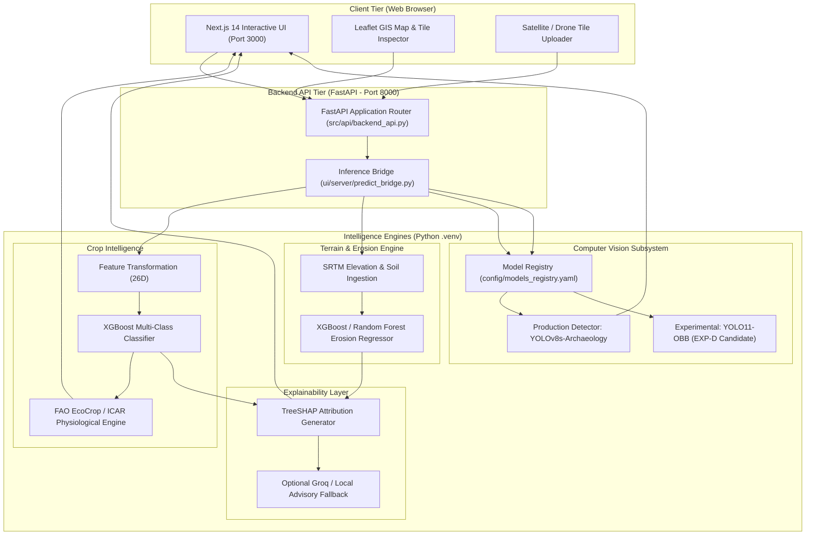

# GeoAgri-AI

### AI-Powered Agricultural Intelligence & Terrain Analysis Platform

**Course:** CSE 471 — Deep Learning for Computer Vision  
**Project Type:** Continuous Assessment (CA) Project  
**Repository:** [GeoAgri-AI-CSE-471](https://github.com/harshilsetty/GeoAgri-AI-CSE-471)

---

## 1. Project Overview

**GeoAgri-AI** is an integrated machine learning platform combining geospatial data processing, agricultural decision intelligence, and aerial computer vision. 

In agrarian landscapes, smallholder farmers, land-use planners, and environmental researchers frequently struggle with fragmented data: soil properties, topography, seasonal rainfall, and physical terrain constraints are rarely synthesized into unified guidance. Furthermore, historical agricultural landscapes often contain cultural heritage and archaeological structures (e.g., ancient masonry walls, terraces, mounds, ruins, irrigation channels) that require preservation and risk-aware planning.

GeoAgri-AI bridges this gap by unifying:
1. **Agronomic Intelligence:** Multi-class crop suitability recommendations and yield-potential estimation grounded in physiological rules.
2. **Terrain Erosion Risk:** Geospatial slope, rainfall, and land-cover modeling to predict soil erosion susceptibility.
3. **Aerial & Satellite Vision:** Oriented Bounding Box (OBB) computer vision for detecting structures, ruins, boulders, and vegetation in aerial survey imagery.
4. **Transparent Explainability:** Model decisions attributed via TreeSHAP feature contributions and agronomic rule validation.

---

## 2. Key Features

### Implemented & Production-Ready
* **Geospatially-Grounded Crop Recommendation:** Multi-class crop prediction taking soil nutrients (N, P, K, pH), weather (temperature, humidity, precipitation), and topography (elevation, slope) into account.
* **Terrain Erosion Prediction:** Machine learning regression and classification modeling soil erosion risk based on topographical curvature, slope steepness, and rainfall erosivity.
* **Archaeological & Terrain Computer Vision:** High-resolution aerial object detection using Oriented Bounding Boxes (OBB) to capture arbitrary angular orientations of architectural ruins, ancient walls, and terrain features.
* **TreeSHAP Explainability:** Exact Shapley additive explanation values highlighting the exact topographic and climatic factors driving each prediction.
* **Agronomic Knowledge Constraints:** Physiological compatibility engine grounded in FAO EcoCrop and ICAR agro-ecological parameters to filter out biologically non-viable recommendations.
* **Interactive Web Platform:** Next.js 14 frontend coupled with an interactive Leaflet geospatial map for point-based spatial analysis and image tile upload.

### Experimental Research Features
* **YOLO11 OBB Experimental Pipeline:** Controlled experiments (EXP-B through EXP-E) evaluating geometry refitting, domain augmentation, inverse-frequency class weighting, and capacity scaling.
* **Inverse-Frequency Loss Weighting:** Custom damped class weighting addressing severe minority class imbalance (`structures` recall recovered to 77.1% on validation).

### Optional / Roadmap Capabilities
* **LLM Agronomic Advisory:** Context-aware plain-English advisory generated via Groq (Llama-3.1) with automatic local fallback when no API key is supplied.
* **Multi-Site Benchmark (AGB-120):** Proposed 120-scene field collection across 6 new Indian archaeological sites to solve cross-site geomorphological domain shift.

---

## 3. System Architecture



---

## 4. Technology Stack

* **Frontend:** Next.js 14, React 18, TypeScript, TailwindCSS, Leaflet / React-Leaflet, Lucide Icons, Framer Motion.
* **Backend:** FastAPI, Uvicorn, Python 3.10+, Pydantic v2, HTTPX.
* **Machine Learning & Data Science:** Scikit-Learn, XGBoost, NumPy, Pandas, Joblib.
* **Computer Vision:** Ultralytics (YOLOv8, YOLO11-OBB), PyTorch (CUDA 12.4 acceleration), OpenCV, PIL, Shapely.
* **Explainable AI (XAI):** SHAP (TreeExplainer).
* **External APIs (Optional):** Groq Cloud API (`llama-3.1-8b-instant`), Open-Meteo Weather API, SoilGrids REST API.

---

## 5. Project Structure

```text
GeoAgri-AI/
├── .env.example                 # Template for environment variables
├── requirements.txt             # Core Python runtime dependencies
├── pyproject.toml               # Package build and test configuration
├── config/
│   └── models_registry.yaml     # Production & experimental model registry
├── src/
│   ├── api/
│   │   └── backend_api.py       # FastAPI application entry point
│   ├── geospatial/              # Soil, terrain, and weather ingestion modules
│   ├── models/                  # Crop intelligence and erosion model definitions
│   ├── explainability/          # TreeSHAP and local sensitivity attribution
│   └── preprocessing/           # 26D agronomic feature engineering
├── models/                      # Production model weights (.pkl, .pt)
├── ui/                          # Next.js 14 frontend application
│   ├── app/                     # Next.js App Router (pages and API proxies)
│   ├── components/              # React UI widgets (maps, cards, gauges)
│   ├── server/                  # predict_bridge.py Python-UI bridge
│   └── package.json             # Node.js dependencies and scripts
├── datasets/                    # Versioned OBB datasets (v2, v3 refitted)
├── runs/                        # Training runs, validation logs, and weights
│   ├── detect/                  # Production YOLOv8s archaeology run
│   └── obb/                     # YOLO11 OBB experimental runs (v1 to v5)
├── scripts/                     # Evaluation, training, and data audit scripts
├── tests/                       # Pytest test suite (API, hardening, math)
└── docs/                        # Scientific reports, audits, and protocols
```

---

## 6. Prerequisites

* **Operating System:** Windows 10/11 (Linux / macOS also supported)
* **Python:** Python 3.10, 3.11, or 3.12 (Python 3.13 supported with pre-compiled wheels)
* **Node.js:** Node.js 18.x or 20.x+ with `npm`
* **Git:** Installed and available in terminal
* **Hardware:**
  - **Minimum:** 8 GB RAM, 4-core modern CPU (supports inference on CPU)
  - **Recommended for CV:** NVIDIA GPU with 6+ GB VRAM (RTX 3050 or higher with CUDA 12.x)

---

## 7. Installation and Setup (Windows Step-by-Step)

Follow these exact commands in **PowerShell**:

### Step 1: Clone or Navigate to Project
```powershell
git clone https://github.com/harshilsetty/GeoAgri-AI-CSE-471.git
cd GeoAgri-AI-CSE-471
```

### Step 2: Set Up Python Virtual Environment
```powershell
python -m venv .venv
.\.venv\Scripts\Activate.ps1
```
*(If execution policy restricts scripts, run `Set-ExecutionPolicy -Scope Process -ExecutionPolicy Bypass` first).*

### Step 3: Install Core Python Dependencies
```powershell
pip install --upgrade pip
pip install -r requirements.txt
pip install ultralytics torch torchvision --index-url https://download.pytorch.org/whl/cu124
```
*(For CPU-only machines, simply run `pip install torch torchvision ultralytics`).*

### Step 4: Configure Environment Variables
Copy the environment template:
```powershell
copy .env.example .env
copy ui\.env.local.example ui\.env.local
```

### Step 5: Install Frontend Dependencies
```powershell
cd ui
npm install
cd ..
```

---

## 8. Environment Variables

The project uses safe defaults and runs fully without paid external services.

| Variable | Scope | Status | Purpose |
| :--- | :--- | :---: | :--- |
| `PREDICT_BACKEND_URL` | Frontend (`ui/.env.local`) | **Mandatory** | Points Next.js to FastAPI (`http://127.0.0.1:8000`) |
| `PYTHON_EXECUTABLE` | Frontend (`ui/.env.local`) | Optional | Absolute path to `.venv\Scripts\python.exe` |
| `GROQ_API_KEY` | Root / UI | Optional | Optional key for Groq LLM advisory (uses local rule fallback if blank) |

---

## 9. Running the Application (Live Demonstration)

To run the complete application, open **two separate terminal windows**:

### Terminal 1: Start Backend API (FastAPI)
```powershell
# From the project root with .venv activated:
.\.venv\Scripts\Activate.ps1
uvicorn src.api.backend_api:app --host 127.0.0.1 --port 8000 --reload
```
* **Backend Health Check:** Open `http://127.0.0.1:8000/health` (should return `{"ok": true}`).
* **Swagger API Docs:** Available at `http://127.0.0.1:8000/docs`.

### Terminal 2: Start Frontend Web UI (Next.js)
```powershell
# From the ui/ folder:
cd ui
npm run dev
```
* **Frontend Web Dashboard:** Open **`http://localhost:3000`** in your browser.

---

## 10. Model Checkpoint & Registry Governance

Model artifacts are managed under strict MLOps isolation in [`config/models_registry.yaml`](file:///c:/Users/HARSHIL%20SOMISETTY/HS/Education/LPU/Academics/SEM%205/CSE%20471%20DEEP%20LEARNING%20FOR%20COMPUTER%20VISION/Arch/GeoAgri-AI/config/models_registry.yaml):

| Subsystem | Model Role | Architecture | Checkpoint Path | Status |
| :--- | :--- | :--- | :--- | :--- |
| **Crop Intelligence** | Production | XGBoost Multi-Class | Built into `src/models/` | **Active Production** |
| **Erosion Modeling** | Production | XGBoost Regressor | `terrain_model/erosion_model.pkl` | **Active Production** |
| **Computer Vision** | Production Baseline | YOLOv8s Detection | `runs/detect/yolov8s_archaeology2/weights/best.pt` | **Active Production** |
| **Computer Vision** | Preferred Experimental | YOLO11n-OBB Weighted | `runs/obb/geoagri_yolo11n_obb_v4_class_weighted/weights/best.pt` | **Experimental Leader** |
| **Computer Vision** | Capacity Scaling Candidate| YOLO11s-OBB Weighted | `runs/obb/geoagri_yolo11s_obb_v5_class_weighted/weights/best.pt` | Evaluated / Overfit |

> **Production Isolation Policy:** Experimental YOLO11 OBB models are strictly quarantined from production deployment until external multi-site validation benchmarks are satisfied.

---

## 11. Computer Vision Experimental Results (AGP 10 – AGP 12)

The computer vision subsystem underwent controlled experimentation on the geometry-refitted archaeological dataset (`datasets/geoagri_obb_v3/data.yaml`):

| Experiment | Model Architecture | Training Strategy | Val mAP@50 | Val mAP@50-95 | Structures Recall | Forward Latency | Status |
| :--- | :--- | :--- | :---: | :---: | :---: | :---: | :---: |
| **EXP-C** | YOLO11n-OBB (2.66M) | Domain Augmentation | **0.4497** | **0.2638** | 0.7222 | 10.1 ms | Baseline Aug |
| **EXP-D** | YOLO11n-OBB (2.66M) | Damped Class Weights | **0.4150** | **0.2514** | **0.7711** | **10.2 ms** | **Selected Candidate** |
| **EXP-E** | YOLO11s-OBB (9.70M) | Capacity Scaling | 0.3797 | 0.2297 | 0.5556 | 13.8 ms | Overfit on 88 scenes |

### Key Experimental Discoveries:
1. **Minority Class Recovery (EXP-D):** Damped inverse-frequency class weighting ($w = [0.95, 1.41, 1.16, 3.88, 0.56]$) broke the historical zero-recall barrier for rare structures, elevating validation recall to **77.1%**.
2. **Failure of Capacity Scaling (EXP-E):** Quadrupling parameters to 9.70M caused early stopping at Epoch 20 due to overfitting on the 88 training scenes, dropping structures recall to 55.6%.
3. **Selected Candidate:** **EXP-D** is established as the preferred experimental OBB checkpoint.

---

## 12. Known Limitations & Research Boundaries

1. **Geographic Confounding:** In the current dataset, 100% of boulders are located in Hampi, while 80%+ of structures are in Pattadakal and Nalanda. Detectors risk learning background lithology shortcuts rather than true structural geometry.
2. **Limited Independent Scenes:** The 109 validation images originate from only **19 unique aerial scenes**, limiting statistical generalization across unseen terrains.
3. **Quarantine of Held-Out Test Split:** The 117-scene test partition was quarantined to prevent benchmark exhaustion; independent generalization must be evaluated on the proposed 120-scene multi-site expansion (AGB-120).

---

## 13. Troubleshooting

* **Problem: `uvicorn` fails with `ModuleNotFoundError: No module named 'src'`**
  * *Solution:* Run uvicorn from the project root directory where `src/` is located.
* **Problem: Frontend shows `Backend Unavailable` or network error**
  * *Solution:* Ensure Terminal 1 is running and `http://127.0.0.1:8000/health` returns `{"ok": true}`. Check that `ui/.env.local` contains `PREDICT_BACKEND_URL=http://127.0.0.1:8000`.
* **Problem: PowerShell blocks virtual environment activation**
  * *Solution:* Run `Set-ExecutionPolicy -Scope Process -ExecutionPolicy Bypass` then reactivate.
* **Problem: CUDA Out of Memory during inference**
  * *Solution:* The models automatically run on CPU if CUDA is unavailable. To force CPU, set `device="cpu"` in configuration.

---

## 14. Academic Project Information

* **Project Title:** GeoAgri-AI: AI-Powered Agricultural Intelligence & Terrain Analysis Platform
* **Academic Course:** CSE 471 — Deep Learning for Computer Vision
* **Academic Term:** Semester 5
* **Evaluation Type:** Continuous Assessment (CA) Project / Final Demonstration
* **Repository:** [https://github.com/harshilsetty/GeoAgri-AI-CSE-471](https://github.com/harshilsetty/GeoAgri-AI-CSE-471)

---

## 15. References & Acknowledgments

* **Ultralytics YOLO:** Jocher, G., et al. (2024). *YOLO by Ultralytics*.
* **TreeSHAP:** Lundberg, S. M., et al. (2020). *From local explanations to global understanding with explainable AI for trees*. Nature Machine Intelligence.
* **Agro-Ecological Principles:** Food and Agriculture Organization (FAO) *EcoCrop Database*; Indian Council of Agricultural Research (ICAR).
* **Geospatial Elevation Data:** NASA Shuttle Radar Topography Mission (SRTM) 30m Global DEM.
