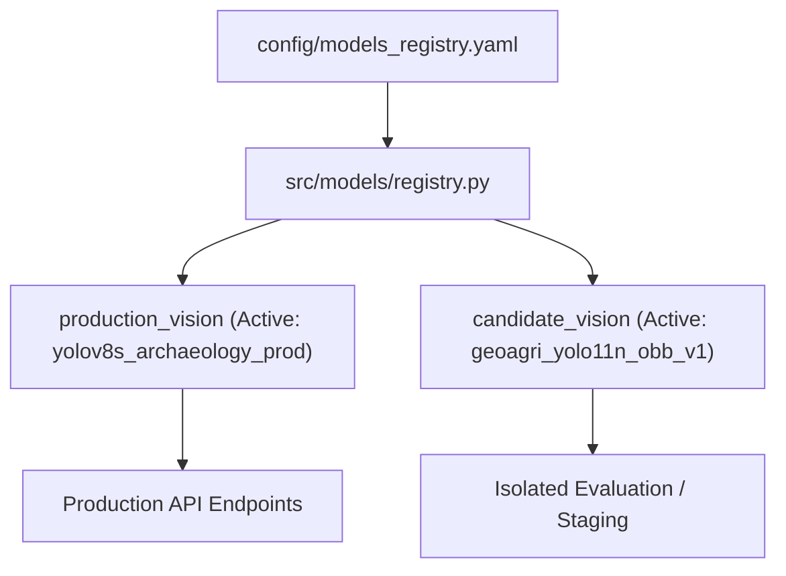

# AGP 08 — Model Versioning & Lifecycle Governance Report

**Author:** MLOps Lead & Release Engineer  
**Date:** October 28, 2026  
**Registry Configuration:** `config/models_registry.yaml`  
**Registry Implementation:** `src/models/registry.py`  

---

## 1. Registry Architecture & Separation of Concerns

To prevent accidental or silent promotion of experimental models to production, GeoAgri-AI implements an explicit, file-based model registry with distinct operational tiers:



---

## 2. Model Operational Status Tiers

Every model registered in `config/models_registry.yaml` must carry one of three explicit status flags:

1. **`experimental`**: Under training or initial parameter exploration. Checkpoints may be overwritten. Not eligible for API routing.
2. **`validation_candidate`**: Training complete, passed smoke test, independently evaluated on held-out test split, under integration validation. Accessible via explicit slot configuration (`GEOAGRI_VISION_SLOT="candidate_vision"`).
3. **`production`**: Satisfied all 7 acceptance gates, approved by release auditor, active by default in all production endpoints.

---

## 3. Registered Model Entries

```yaml
models:
  # Current Production Baseline
  yolov8s_archaeology_prod:
    name: "YOLOv8s Archaeology Detection"
    version: "1.0.0"
    task: "detection"
    status: "production"
    checkpoint_relpath: "runs/detect/yolov8s_archaeology2/weights/best.pt"
    dataset_version: "archaeological_sites_v1"
    classes: [boulders, others, ruins, structures, vegetation]
    input_size: 640
    promoted_at: "2026-10-09"
    approval_record: "Initial production baseline deployment"

  # Current Candidate (Oriented Bounding Box)
  geoagri_yolo11n_obb_v1:
    name: "YOLO11n-OBB Cultural Heritage"
    version: "2.0.0-rc1"
    task: "obb"
    status: "validation_candidate" # Explicitly NOT promoted to production
    checkpoint_relpath: "runs/obb/geoagri_yolo11n_obb_v1/weights/best.pt"
    dataset_version: "geoagri_obb_v2"
    training_epochs_completed: 39
    classes: [boulders, others, ruins, structures, vegetation]
    input_size: 640
    test_metrics:
      mAP50: 0.1412
      mAP50_95: 0.0713
      structures_mAP50: 0.0266
    evaluation_report: "docs/final_yolo_evaluation_report.md"
    promoted_at: null
    approval_record: "Requires minority structures class augmentation before production promotion"
```

---

## 4. Promotion & Rollback Protocol

### 4.1 Promotion Barrier
No automated script is permitted to update `active_models.production_vision`. Promotion requires:
1. All 7 acceptance gates passing with verified test logs.
2. Explicit commit updating `status: "production"` and `promoted_at: "<timestamp>"`.
3. Documented approval record in the registry YAML.

### 4.2 Instant Rollback
In the event that an active model exhibits anomalous behavior:
```yaml
# Instant rollback in config/models_registry.yaml:
active_models:
  production_vision: "yolov8s_archaeology_prod"
```
Takes effect immediately upon next server reload with zero code changes.

