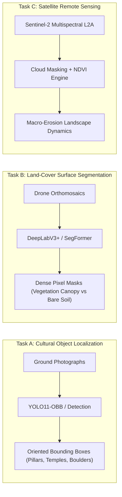

# AGP 09 — Multimodal Land-Cover & Satellite Remote Sensing Roadmap

**Author:** Senior Remote Sensing Specialist & Geospatial ML Engineer  
**Date:** October 28, 2026  
**Project:** GeoAgri-AI  
**Scope:** Architectural Separation of Object Detection, Semantic Segmentation, and Satellite NDVI  

---

## 1. Architectural Decoupling: Object vs. Surface Analysis

GeoAgri-AI requires two fundamentally different spatial analysis paradigms that must not be conflated:



### The Non-Negotiable Boundary:
* **Bounding Boxes $\neq$ Surface Coverage:** Calculating vegetation or bare-soil ratio by summing OBB bounding-box pixel areas introduces an error margin of **25% to 50%**, because rectangular boxes enclose significant open space, sky, and non-target terrain.
* **Prohibition of False Mask Synthesis:** OBB annotations must never be rasterized into pseudo-masks for semantic segmentation training.

---

## 2. Task B: Drone-Based Semantic Segmentation Strategy

To obtain legitimate pixel-level surface coverage:
1. **Source Imagery:** Low-altitude unmanned aerial vehicle (UAV) orthomosaics flown at $50 - 100\text{ m}$ above ground level (ground sampling distance: $2 - 5\text{ cm/pixel}$).
2. **Target Classes:**
   - `0: background / unclassified`
   - `1: exposed bare soil`
   - `2: dense canopy vegetation`
   - `3: low scrub / herbaceous grassland`
   - `4: exposed rock / bedrock outcrop`
   - `5: structural masonry`
3. **Candidate Architecture:** SegFormer-B0 / B1 (hierarchical Vision Transformer) or DeepLabV3+ with ResNet-34 backbone, operating at $512 \times 512$ tile resolution.

---

## 3. Task C: Satellite-Based Remote Sensing & NDVI Integration

### 3.1 Satellite Platform & Spectral Bands
* **Constellation:** European Space Agency (ESA) **Sentinel-2A/B** (Copernicus Programme).
* **Product Level:** **Level-2A (L2A)** Bottom-Of-Atmosphere (BOA) surface reflectance.
* **Key Spectral Bands:**
  - **Band 4 (Red):** Central wavelength $665\text{ nm}$, spatial resolution **$10\text{ m}$**.
  - **Band 8 (Near-Infrared / NIR):** Central wavelength $842\text{ nm}$, spatial resolution **$10\text{ m}$**.
  - **Band 11 & 12 (Short-Wave Infrared / SWIR):** Central wavelength $1610\text{ nm} / 2190\text{ nm}$, spatial resolution **$20\text{ m}$** (used for Soil Moisture and Bare Soil Index - BSI).

### 3.2 Normalized Difference Vegetation Index (NDVI) Formulation
$$\text{NDVI} = \frac{\rho_{\text{NIR}} - \rho_{\text{Red}}}{\rho_{\text{NIR}} + \rho_{\text{Red}}} = \frac{\text{Band 8} - \text{Band 4}}{\text{Band 8} + \text{Band 4}}$$

* Values range from $-1.0$ to $+1.0$:
  - $\text{NDVI} < 0.1$: Water, bare rock, ancient masonry.
  - $0.1 \le \text{NDVI} < 0.25$: Bare soil, dry sparse scrub.
  - $0.25 \le \text{NDVI} < 0.50$: Moderate crop cover / sparse grassland.
  - $\text{NDVI} \ge 0.50$: Dense tropical canopy / irrigated agriculture.

### 3.3 Remote Sensing Challenges & Limitations

1. **Temporal Mismatch:**
   - Ground photographs capture a static instant (e.g. October 2026 dry season).
   - In semi-arid regions like Hampi (Karnataka), vegetation turns dry brown between February and May, reducing optical NDVI from 0.45 to 0.15 without any change in physical shrub biomass. Satellite imagery must be acquired within $\pm 7$ days of ground surveys to maintain radiometric validity.
2. **Cloud and Cloud-Shadow Masking:**
   - Automated cloud screening must be applied using Sentinel-2 **Scene Classification Layer (SCL)**, masking pixels classified as Cloud High/Medium Probability (SCL 8, 9), Thin Cirrus (SCL 10), and Cloud Shadows (SCL 3).
3. **Spatial Resolution Mismatch:**
   - Sentinel-2's $10\text{ m} \times 10\text{ m}$ pixels represent a $100\text{ m}^2$ footprint on the ground. A single satellite pixel may contain an ancient stone pillar ($2\text{ m}^2$), a granite boulder ($15\text{ m}^2$), and thorny scrub ($83\text{ m}^2$). This "mixed pixel" phenomenon means NDVI cannot replace ground-level object detection.
4. **Georeferencing & Site Boundaries:**
   - Current ground photographs lack differential GNSS RTK coordinates. Exact alignment requires extracting spatial polygons (GeoJSON boundaries) for monuments from the Archaeological Survey of India (ASI) geospatial database.

---

## 4. Multimodal Fusion Architecture

```
[Ground YOLO11n-OBB] --------> Object Count & Archaeological Preservation Priority
[Satellite Sentinel-2 NDVI] -> Macro-Vegetation Density & Seasonal Biomass Index
[Open-Meteo API] ------------> Precipitation & Slope Geospatial Parameters
                                      |
                                      v
                        [XGBoost Erosion Classifier]
                                      |
                                      v
                       Calibrated Terrain Risk Probability
```

This decoupled architecture allows each sensor modality to operate within its valid physical domain without fragile approximations.

